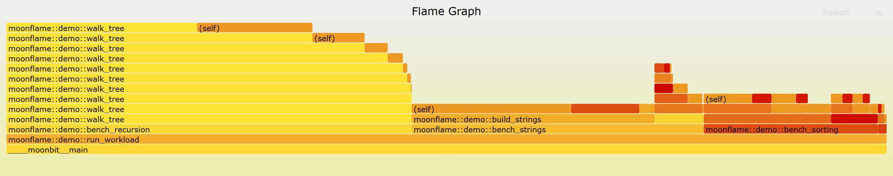
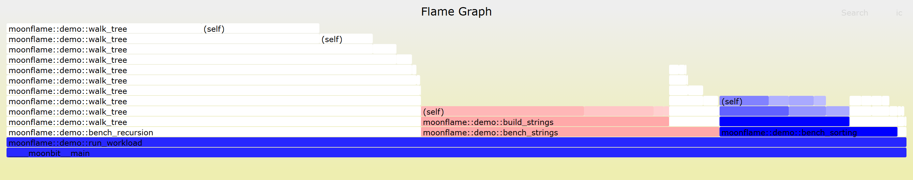

# MoonFlame

**用 MoonBit 将折叠栈性能数据转换成可交互的 SVG 火焰图。**

生成的 SVG 是一个自包含文件，可以在浏览器离线打开、归档和分享。
MoonFlame 提供可复用的纯计算库及命令行工具；采样由上游工具完成。



下载 [SVG 示例](examples/flame.svg) 并用浏览器打开，可体验悬停、缩放与搜索。
GitHub README 的图片引用只显示静态图，不会执行 SVG 内的脚本。

## 环境与快速验证

当前版本：`0.2.0`。需要 `moonc >= 0.10.14`，首次安装后执行 `moon update`。
生成端需要 MoonBit 工具链；查看 SVG 只需要浏览器。核心库没有第三方依赖；
命令行使用官方 `moonbitlang/x@0.4.45` 读写文件、设置退出状态。

```bash
# macOS / Linux 安装 MoonBit
curl -fsSL https://cli.moonbitlang.com/install/unix.sh | bash
```

```powershell
# Windows 安装 MoonBit
irm https://cli.moonbitlang.com/install/powershell.ps1 | iex
```

```bash
moon version --all
moon update
moon run cmd/main -- testdata/demo.folded --out flame.svg
moon run cmd/main -- hotspots testdata/demo.folded --top 10
```

默认 CLI 目标为 native。Windows 干净环境的标准验证配置为 **MSVC 开发者终端**；
CI 显式配置 MSVC。旧版 0.10.14 运行时在 MinGW 下存在 `rand_s` 声明问题，
不自动修改用户工具链，也不把本机运行时补丁作为干净环境证明。
本机该版本的 native CLI 对含非 ASCII 字符的 Windows 绝对路径有限制；
可在对应目录使用相对路径，或使用 JS CLI。

核心库检查、构建和测试覆盖 wasm、wasm-gc、JS、native；CLI 流和退出码的
端到端验证覆盖 native、JS、WASI wasm。JS 用法：

```bash
moon run --target js cmd/main -- testdata/demo.folded --out flame.svg
```

`moonc 0.10.14` 的 wasm-gc `eprintln` 会回退到标准输出，因此该目标不属于
支持流重定向契约的 CLI 目标；命令行使用 native、JS 或 WASI wasm。
这不影响 wasm-gc 环境调用纯计算库。

## 输入、数据与核心功能

折叠栈每行是一条调用路径，最后一个空格分隔权重；帧间用分号分隔：

```text
main;compute;fft 900
main;compute 100
```

权重必须为**有限非负数**。空行忽略，零和负零允许但不参与聚合；负数、NaN、
Infinity、无效数值和缺少权重都属于无效行。空帧名以 `(root)` 显示。
`--unit` 声明输入权重含义：`ns / us / ms / s / count`，默认纳秒。
时间自动缩放，计数按原值显示；不要将不明单位的权重直接解释为耗时。

- 聚合在同父同名的节点间进行，原始名称作为身份；显示归一化不改写输入数据。
- 默认保留 32 个真实帧，超出部分进入 `(deeper)`，不丢失深部权重。
- 布局按权重比例切分；有子项的节点以 `(self)` 补齐自身权重，消除舍入裂缝。
  渲染会省略过小矩形，因此可见矩形不承诺覆盖所有子项。
- 火焰图根在底部，`--inverted` 改为根在顶部的冰柱图。
- 同输入产生确定性输出，同名帧同色；普通图采用暖色，差异图红增蓝减白不变。

| 冻结样例 | 含义 |
| --- | --- |
| `testdata/demo.folded` | 本项目演示程序的真实采样：32 条合并栈、最深 13 帧、总权重约 1893 ms |
| `testdata/stress-recursive.folded` | 上游样例的冻结剖面转换：最深 7254 帧，用于深度限制和不限深回归 |
| `testdata/demo-baseline.folded` | 人工构造的演示基线，不是另一次真实采样 |

样例来源、固定提交、生成步骤及适用许可证见
[第三方材料说明](THIRD_PARTY_NOTICES.md)，SHA-256 见
[testdata/SOURCES.json](testdata/SOURCES.json)。

## 命令行

```text
moon run cmd/main -- <input> [options]
moon run cmd/main -- hotspots <input> [--top N]
moon run cmd/main -- callers <input> <name>
moon run cmd/main -- callees <input> <name>
moon run cmd/main -- diff <before> <after> [-o out.svg]
moon run cmd/main -- delta <before> <after> [--top N]
moon run cmd/main -- filter <pattern> <input> [-o out.folded]
```

| 出图参数 | 默认值 | 约束 |
| --- | --- | --- |
| `-o, --out` | 标准输出 | 指定则写文件 |
| `--width` | 1400 | 有限且大于 20 像素（左右各留白 10） |
| `--max-depth` | 32 | 非负整数；0 表示不限深 |
| `--unit` | ns | 必须为已知单位；也接受代码中定义的完整单位别名 |
| `--inverted` | 关闭 | 冰柱方向 |

报告命令接受深度和单位；`hotspots`、`delta` 另接受 `--top`，默认 10，
0 表示全部，负数无效。`filter` 只接受过滤子串、输入和输出参数。
参数写错会报错，不会悄悄退回默认值。

命令行严格验证所有输入行：只要一行无效，整次失败，不生成部分结果，
也不打开或截断已有输出文件。库解析接口提供逐行诊断，可由调用方自行决定容错策略。
所有诊断和写入提示进入标准错误，标准输出只包含结果。

| 退出码 | 含义 |
| --- | --- |
| 0 | 成功、帮助、版本查询；过滤零匹配也是成功 |
| 1 | IO、输入数据、计算或数值校验失败 |
| 2 | 参数错误 |

过滤零匹配时输出为空；指定输出路径会以空文件替换旧结果，避免下游误用旧数据。
普通渲染和报告在没有正权重样本时失败。

### 报告与差异

`callers` 按直接调用者、`callees` 按直接被调用者分组。查询先做显示名归一化再按
子串匹配，分组身份始终是原始完整名称。同一样本对同一条目最多贡献一次，即使自递归
或互递归也不重复累计；每条占比不超过 100%，不同条目可能重叠，合计不保证为 100%。
限深后的报告会提示 `(deeper)` 收纳了未展开的部分。

```bash
moon run cmd/main -- callers testdata/demo.folded walk_tree
moon run cmd/main -- callees testdata/demo.folded build_strings
moon run cmd/main -- filter build_strings testdata/demo.folded -o sub.folded
moon run cmd/main -- sub.folded --out sub.svg
moon run cmd/main -- diff testdata/demo-baseline.folded testdata/demo.folded -o diff.svg
moon run cmd/main -- delta testdata/demo-baseline.folded testdata/demo.folded
```

差异图**宽度按当前（第二份）剖面**，节点颜色表示累计权重变化；`(self)` 表示
自身权重变化，独立计算，不会把消失子调用的变化错误归到父函数自身。
**仅基线存在的帧不显示**，可交换输入生成另一方向，或用 `delta` 查看消失函数。
文本 `delta` 按函数自身权重变化排序，显示所有只在一侧存在的函数。

演示基线规则：含 `bubble__sort` 的行权重乘 3，含 `build__strings` 的行乘 0.8，
向下取整，其余不变。不要把该构造基线作为真实性能改善证据。



### SVG 交互

| 操作 | 行为 |
| --- | --- |
| 悬停 | 帧名、权重、全图占比和变化量 |
| 单击 | 缩放到该子树；祖先半透明，点击祖先可扩大视图 |
| Reset Zoom | 恢复原始几何和显示状态 |
| Ctrl-F / Search | 正则搜索；再次点击重置 |
| Ctrl-I / ic | 切换是否忽略大小写 |

搜索占比相对**当前视图**，命中区间取并集，排除隐藏帧和仅作上下文的祖先。
无命中显示 0%，无效正则明确提示。窄帧放大后会出现可容纳的标签。
内嵌脚本需直接打开 SVG 或内联嵌入；`` 引用只显示静态图。

## 作为库使用

注册表模块为 `gywcs101/moonflame`；0.2.0 为本次整改准备的版本，正式发布状态以
[mooncakes 模块页](https://mooncakes.io/docs/gywcs101/moonflame)为准。
发布后可执行 `moon add gywcs101/moonflame`。

在调用项目的 `moon.pkg` 中添加包导入：

```text
import {
  "gywcs101/moonflame",
}
```

在源码中使用以下完整链路。此段由独立消费项目实际编译和执行：

```moonbit
///|
pub fn folded_to_svg(text : String) -> String raise {
  let parsed = @moonflame.parse_folded(text)
  if parsed.skipped_lines > 0 { fail("invalid profile") }
  let tree = @moonflame.aggregate(parsed.samples, max_depth=32)
  let layout = @moonflame.layout(tree, 1380.0, @moonflame.FRAME_HEIGHT)
  @moonflame.render_svg(layout)
}
```

`ParseResult.diagnostics` 包含一基行号和错误类别。核心入口可能抛出可捕获的
`ValidationError`（权重、树结构或几何错误），可向上传播或分别捕获。
库允许空树产生空 SVG；CLI 为避免误解会拒绝没有正权重的剖面。

| API | 参数含义 |
| --- | --- |
| `parse_folded(text)` | 有效样本及逐行诊断 |
| `aggregate(samples, max_depth=...)` | 非负样本聚合 |
| `layout(tree, width, row_height)` | 内容宽度，不含渲染留白 |
| `render_svg(layout)` | 生成完整 SVG |
| `top_hotspots(tree, top)` | 按自身权重聚合热点 |
| `find_callers(tree, name)` / `find_callees(tree, name)` | 调用关系覆盖统计 |
| `diff_against(current, baseline)` | 当前树的累计与自身变化 |
| `compute_delta(before, after, top)` | 函数自身权重差异 |
| `filter_folded(text, pattern)` | 保留匹配栈的原始权重 |

完整签名见 `pkg.generated.mbti`。版本迁移与行为调整见 [MIGRATION.md](MIGRATION.md)。
Double 权重的整数精度受 IEEE-754 限制，大于 2^53 的整数不保证精确表示。

## 采样自己的程序

安装可选采样器 [mizchi/moon-pprof](https://github.com/mizchi/moon-pprof)，
采样端需要它的运行环境；渲染器不依赖采样器。以下为用 0.1.3 验证的 wasm-gc 链路：

```bash
moon build --target wasm-gc
moon-pprof profile --wasm-gc _build/wasm-gc/debug/build/cmd/main/main.wasm --iterations 3 --out app.pb.gz
moon-pprof pprof2folded app.pb.gz app.folded
moon run cmd/main -- app.folded --out flame.svg
```

项目内演示负载使用 `powershell demo/reproduce.ps1` 或 `bash demo/reproduce.sh`。
工具需位于 PATH。新的采样结果会变化，冻结测试数据不应自动覆盖。
0.1.3 历史实验中，调用密集与循环密集负载的采样密度有明显差异；该观察受采样器、
负载与环境影响，不能据此断言所有短函数都采不到或延长运行永远无益。
其他后端采样能力以所用上游版本的文档为准。

## 开发与复验

```bash
moon check --target all --deny-warn
moon build --target all --deny-warn
moon test --target all --deny-warn
moon fmt --check
moon info
python scripts/test-cli.py
python scripts/test-cli.py --target js
python scripts/test-cli.py --target wasm
python scripts/test-consumer.py
python scripts/verify-fixtures.py
npm ci --prefix tests/browser --ignore-scripts
node tests/browser/node_modules/playwright/cli.js install chromium
node tests/browser/test.cjs
moon package
python scripts/verify-package.py
```

`demo/` 是独立模块，在该目录另行运行 `moon check --deny-warn` 和 `moon test --deny-warn`。
CI 保留三平台四后端检查，并增加真实进程、浏览器交互、外部消费和分发材料检查。
浏览器测试使用 Node 20+ 和锁定的 Playwright 开发依赖，不进入核心库运行依赖。
可通过 `PLAYWRIGHT_CHROMIUM_EXECUTABLE` 指定已有 Chromium。

核心文件按解析、聚合、校验、布局、渲染、报告和命令行分层；`cmd/main` 是 IO 入口。
许可证说明、复现脚本和测试脚本随仓库提供。整改对照和验证边界见
[REMEDIATION.md](REMEDIATION.md)。

## 参考与许可

原创部分采用 [MIT](LICENSE)。外观、折叠栈与交互语义参考
[FlameGraph](https://github.com/brendangregg/FlameGraph)（CDDL-1.0），未复制其源码。
上游样例及相关衍生数据随附 [Apache-2.0 完整许可证](LICENSES/Apache-2.0.txt)。
详见 [THIRD_PARTY_NOTICES.md](THIRD_PARTY_NOTICES.md)。
